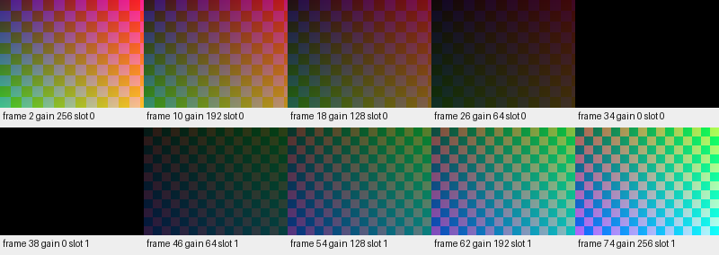

# 扩展要求1 淡出换图后淡入

日期：2026-10-25。交付状态：**三个生产RTL模块、独立仿真和RTL像素预览已完成；整机连接、TD时序和板上验收待队友完成。**

对应选题指南1.4扩展要求（1）的“淡入淡出”。方式是旧图逐帧变暗、黑色期间换图、新图逐帧变亮，不要求额外同时读取第二张图片。最终是否通过扩展赛项仍以实际整机演示和评审为准。

## 直接看效果

以下动画来自`team_fade_effect`的RTL仿真输出RGB，按名义60fps播放；**不是板卡录像**。GIF采用调色板，实际颜色/同步核对使用仿真的完整RGB888数据。




## 文件入口

| 文件 | 用途 |
|---|---|
| rtl/team_fade_rgb.v | RGB888乘亮度系数，四舍五入，像素与HS/VS/DE及可选坐标统一两级寄存 |
| rtl/team_fade_ctrl.v | 帧边界调整亮度、黑帧保持、切图握手、请求编号、超时及故障恢复 |
| rtl/team_fade_effect.v | 推荐给整机实例化的封装，连接以上两个模块 |
| INTEGRATION.md | 队友需要接哪些线、回复的真实含义、跨域与时序约定 |
| DEEPSEEK_INTEGRATION.md | 可直接给队友harness的集成请求 |
| sim/ | 三个独立测试平台；含完整640×480视频流 |
| tools/run_fade_regression.py | 一次运行30项测试并从实际RTL像素生成预览 |
| PROGRESS.md | 此扩展的交付与待验收状态 |

## 最小接入原则

在新整机的“显示读出RGB/同步信号”和“RGB转AXIS视频流”之间插入`team_fade_effect`。请求先给淡化模块，由它在黑色阶段提出真正的换帧请求；不要让原按键控制器提前直接切帧。

**切图确认必须表示目标图片已进入可用的显示读取通路，旧读FIFO数据已隔离。不能直接把`team_frame_commit_bridge.select_done`当成该确认。**这一步由队友的读调度器/适配层完成，详细契约见INTEGRATION.md。

全部端口属于视频时钟域。来自其它时钟域的控制、请求、编号与完成事件需通过可靠握手传输。此模块不修改TF、FAT32、BMP、帧存储、音频或旧参考例程。

## 复测

在`team_media_player`根目录运行，沿用该项目已有Python/Pillow和Icarus环境：

```text
python extensions/fade/tools/run_fade_regression.py
```

也支持`--iverilog-bin D:/tools/iverilog/bin`或`IVERILOG_BIN`/PATH。脚本不会安装软件、访问实卡或下载板卡。

通过标记：`ALL_PASS cases=30`。`--case ctrl_normal_step8`可以只运行一个指定案例。原始日志每次新建在本目录`records/`。接手冻结包时可先运行`python extensions/fade/tools/verify_fade.py`核验本扩展文件；后续有意修改后旧manifest会报告正常的变化。

基础工程仍按已核实的45/100记录；队友未上传的本地工作未知，本扩展不擅自覆盖基础进度。完整赛项还需要文档中的整机与板上验收。
